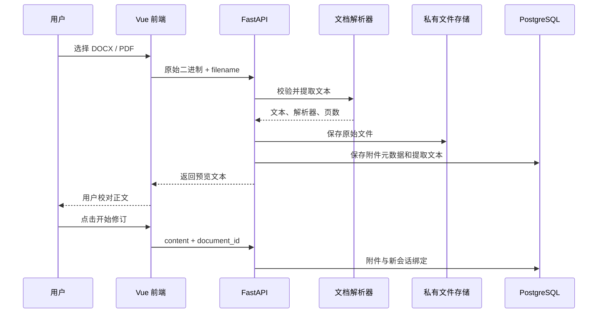
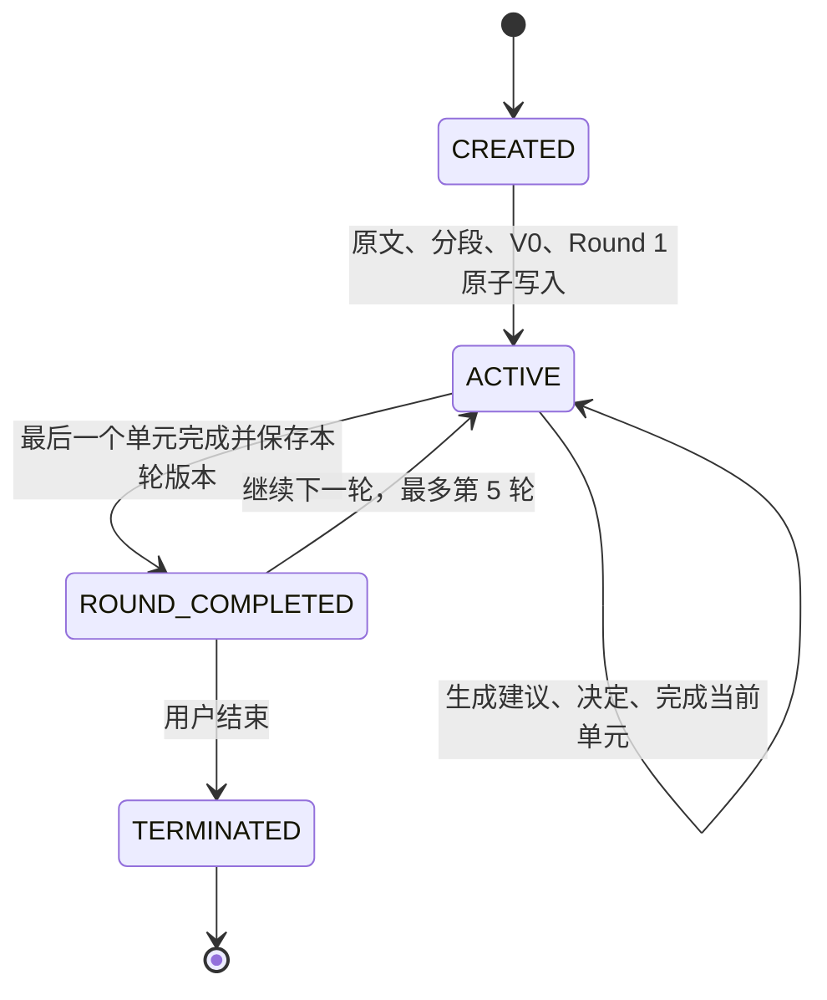
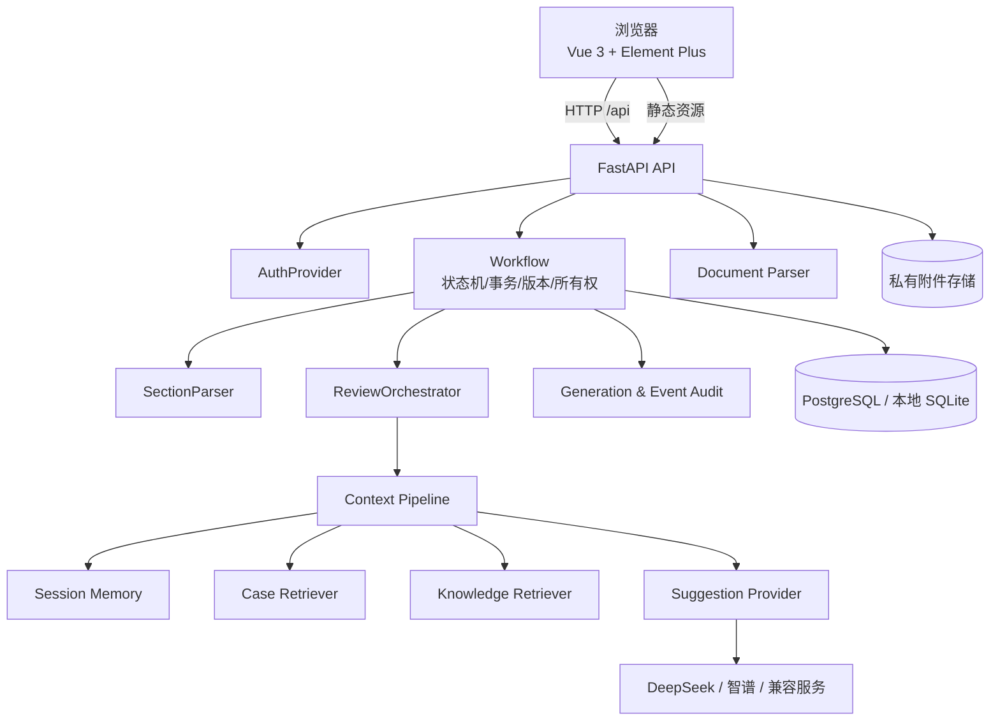
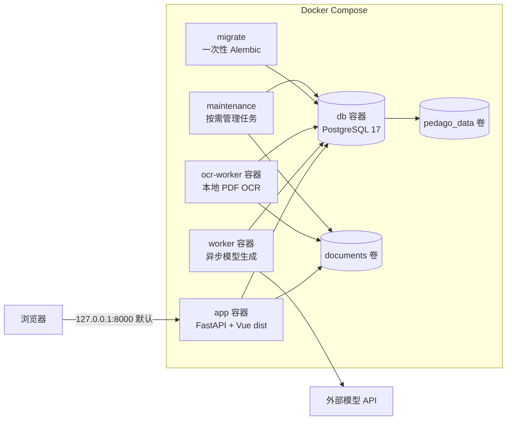
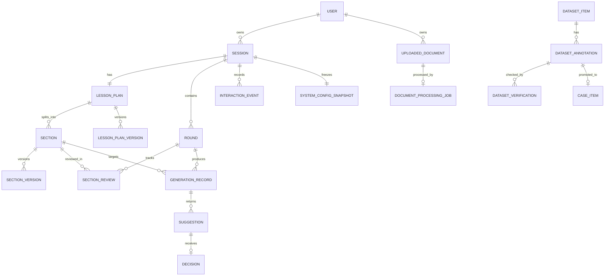

# PedagoLoop 系统需求与架构说明

> 文档版本：1.1  
> 对应系统：PedagoLoop / NoviceTeacher-AI `0.2.0-alpha`  
> 更新日期：2026-10-11  
> 文档依据：当前仓库代码、数据库模型、迁移、测试、部署脚本和既有验收记录

## 1. 文档目的

本文档描述 PedagoLoop 当前版本的产品需求、用户流程、功能边界、软件架构、数据架构、接口、部署方式和已知限制。它有三个用途：

1. 作为与导师讨论研究系统设计时的统一底稿；
2. 作为后续开发、测试和服务器部署的基线；
3. 防止把“已有扩展接口”“已有原始数据”和“已经可供用户使用的功能”混为一谈。

本文中的状态定义如下：

| 状态 | 含义 |
|---|---|
| 已实现 | 当前网页或服务端已有完整可运行链路，并有相应测试或验收记录 |
| 部分实现 | 核心能力已存在，但仍依赖命令行、人工操作或缺少完整界面 |
| 占位/未启用 | 数据结构或接口已经预留，但当前配置明确关闭 |
| 未实现 | 当前代码中没有形成可用功能 |

## 2. 系统定位

PedagoLoop 是一个面向新手教师的研究型教案修订系统。教师提交已有教案后，系统将教案切分为教学功能单元，逐单元生成最多两条建议。教师可采纳、拒绝，或输入自定义要求反复生成候选，直到最终决定。系统保存每一次建议、要求、决定、正文变化、上下文来源和轮次版本。

系统强调的是“教师判断、系统辅助、过程可追踪”，而不是自动替教师重写整份教案。当前版本适合内部试用、教授演示和研究流程验证，尚不能据此声称 AI 建议具有稳定的教学正确性，也不能声称系统已促进教师专业成长。

### 2.1 核心目标

- 支持粘贴文本或上传文件开始教案修订；
- 将长教案切分成数量可控、原文无损的教学单元；
- 每次只呈现少量建议，让教师逐条作出明确决定；
- 支持多轮迭代，并保留 V0、每轮版本和单元版本链；
- 支持 DeepSeek、智谱及其他 Chat Completions 兼容模型；
- 支持可替换的上下文、记忆、案例检索、知识检索和修订策略；
- 保存完整研究过程，使一次修订可以恢复、审计和导出；
- 使用 PostgreSQL 和独立附件卷，使业务数据能够备份并迁移到服务器。

### 2.2 当前明确不承担的目标

- 不自动给教师、教案或教学能力打成长分；
- 不把未经人工核验的 1118 条原始批注直接作为可信知识；
- 不宣称模型建议等同于课程标准、专家意见或实证结论；
- 不提供正式的多人账号、注册、密码登录、权限管理后台；
- 不提供公网生产环境所需的 HTTPS、反向代理、限流和运维监控；
- 不保留 Word/PDF 的完整排版、图片、公式和页布局到修订正文中。

## 3. 用户、角色与使用场景

### 3.1 当前用户角色

| 角色 | 当前实现 | 能力 |
|---|---|---|
| 教师/试用者 | 已实现为服务器配置的 development 用户 | 上传或粘贴教案、选择模型、修订、恢复、下载和导出自己的会话 |
| 数据核验人员 | 部分实现，仅命令行 | 核验数据集批注、提升案例、核验知识条目 |
| 系统运维人员 | 部分实现，仅命令行和 Docker | 迁移数据库、备份、恢复、配置模型和运行测试 |
| 管理员 | 仅有 `role` 字段 | 没有管理网页，也没有角色权限规则 |

`DevelopmentAuthProvider` 从服务器配置读取固定用户名并创建或恢复对应用户。客户端不能通过请求头或请求体伪装成其他用户。该机制用于本机或受控内部环境，不是正式登录系统。

### 3.2 主要使用场景

1. 教师粘贴一份教案并开始修订；
2. 教师上传 DOCX、文本型或扫描型 PDF，核对提取/OCR 正文后开始修订；
3. 教师选择已配置的 DeepSeek、智谱或其他兼容模型；
4. 教师逐节生成建议，采纳、拒绝或自定义再生成，最终决定后进入下一单元；
5. 教师完成一轮后继续下一轮，或结束并查看最终教案；
6. 教师刷新页面、通过会话编号、历史列表或恢复链接继续工作；
7. 研究人员导出完整会话记录，用于后续分析；
8. 核验人员在后台审查原始批注，并将合格内容提升为案例或知识；
9. 运维人员通过 Docker Compose 启动、备份和迁移系统。

## 4. 功能需求总表

| 编号 | 功能模块 | 状态 | 当前要求与行为 |
|---|---|---|---|
| FR-01 | 系统启动与能力发现 | 已实现 | 网页启动时读取健康状态、当前用户、模型列表、知识/案例计数和历史会话 |
| FR-02 | 文本教案导入 | 已实现 | 填写学科、年级、课题并粘贴最多 100000 字正文 |
| FR-03 | Word/PDF 上传 | 已实现 | 接受 DOCX、文本型或扫描型 PDF，最大 15 MB；保存原文件并提取可编辑文本 |
| FR-04 | 上传正文确认 | 已实现 | 提取内容先进入文本框，用户可校对后再创建会话 |
| FR-05 | 模型选择 | 已实现 | 新会话可选择服务器已配置密钥的模型 profile；会话创建后冻结配置 |
| FR-06 | 幂等创建 | 已实现 | 浏览器保存 `request_key` 和待提交载荷，网络异常重试不会重复创建会话 |
| FR-07 | 教案分段 | 已实现 | 依据标题和教学标签无损切分；Alpha 默认最多合并为 10 个单元 |
| FR-08 | 逐单元建议 | 已实现 | 每轮每个单元生成 0–2 条建议；空建议同样记录为一次成功生成 |
| FR-09 | 建议采纳/拒绝 | 已实现 | 每条建议只能作出一次决定；拒绝不改变正文，采纳产生可追踪的正文变化 |
| FR-10 | 安全替换与追加 | 已实现 | 唯一定位时局部替换；定位失败时展示候选，由用户确认是否作为补充追加 |
| FR-11 | 单元与轮次状态机 | 已实现 | 必须生成并处理全部建议后才能完成单元；完成所有单元后才结束一轮 |
| FR-12 | 多轮修订 | 已实现 | 最多 5 轮；每轮完成时保存整份教案版本，禁止第 6 轮 |
| FR-13 | 版本查看 | 已实现 | 可查看 V0 和每轮完成版本；单元每次实际修改也保存版本链 |
| FR-14 | 历史与恢复 | 已实现 | 支持当前用户历史列表、会话编号、URL 参数、恢复链接和刷新恢复 |
| FR-15 | 文件与结果下载 | 已实现 | 可下载原始上传文件、当前/历史文本版本和完整研究 JSON |
| FR-16 | 上下文组装 | 已实现 | 当前单元必选，可组合教案关联单元、会话记忆、知识、案例和偏好贡献器 |
| FR-17 | 案例库 | 部分实现 | 只检索人工核验并提升的案例；导入、核验和提升目前使用命令行 |
| FR-18 | 知识库 | 部分实现 | 只检索人工核验的独立知识条目；导入和核验目前使用命令行 |
| FR-19 | 原始数据集 | 已实现为后台资料 | 已导入 41 份教案元数据和 1118 条原始批注；原始批注默认不进入检索 |
| FR-20 | 研究审计 | 已实现 | 保存上下文、检索、原始模型返回、建议、决定、版本、事件序列和时间戳 |
| FR-21 | 会话消息记录 | 部分实现 | 教案提交、模型建议和决定写入 chat_messages；当前没有自由对话界面 |
| FR-22 | 自定义再生成 | 已实现 | 对当前候选提交要求、异步生成下一版，可重复直到最终采纳或拒绝；自由聊天式主动探询仍未实现 |
| FR-23 | 用户偏好 | 占位/未启用 | 表和 contributor 已预留；默认 NoPreferenceProvider 返回空 |
| FR-24 | 数据集只读清洗 | 已实现为离线工具 | 不改原始文件、不连业务库、不调用外部模型，生成派生清洗结果和报告 |
| FR-25 | Docker/PostgreSQL | 已实现 | 应用、模型 Worker、OCR Worker、数据库、迁移和维护工具由 Compose 编排 |
| FR-26 | 备份与恢复 | 已实现为运维工具 | 配套保存 PostgreSQL dump、附件归档和 SHA-256 清单；只恢复到空目标 |
| FR-27 | 正式身份认证 | 未实现 | 尚无密码登录、JWT、OAuth、会话 Cookie 或管理后台 |
| FR-28 | 网页 OCR | 已实现 | 扫描/部分扫描 PDF 保存后进入持久任务；服务器本地逐页识别、显示进度、失败可重试 |

## 5. 完整用户流程

### 5.1 启动与首页

前端加载后依次获取：

- `/api/health`：数据库连通性、provider、是否有可用模型、默认模型和最大轮数；
- `/api/me`：当前服务端身份；
- `/api/capabilities`：contributors、可选模型、已核验案例数、已核验知识数、原始批注数；
- `/api/sessions`：当前用户的历史会话。

首页展示四阶段进度：导入教案、逐节修订、轮次回顾、最终教案。页面明确标识当前是 Mock 还是实际模型，并显示案例库、知识库和原始批注状态。

### 5.2 教案输入

用户需要提供：

- 学科：1–100 字；
- 年级：1–100 字；
- 课题：1–200 字；
- 教案正文：1–100000 字；
- 模型 profile：可选，未填写时使用服务器默认 profile。

用户也可以使用内置的三年级数学《分数的初步认识》样例。

### 5.3 文件上传

上传流程如下：



约束：

- 只接受 `.docx` 和 `.pdf`；旧 `.doc` 不属于在线上传格式；
- 最大文件 15 MB；
- DOCX 必须是有效 ZIP/Open XML，正文 XML 最大 8 MB；
- PDF 最大 300 页，不接受需要密码的加密文件；
- PDF 必须含有可提取文字，扫描图片 PDF 会被拒绝；
- 提取后文本不得为空或超过 100000 字；
- DOCX 表格按行和单元格提取为文本，样式、图片和公式不进入可编辑正文；
- 原文件保留在私有附件存储，提取文字在用户确认后成为 V0；
- 一个附件只能绑定一个会话，避免同一上传记录被重复复用。

### 5.4 创建会话与分段

浏览器创建 UUID `request_key`，并把请求编号和载荷临时存入 localStorage。若网络结果不明确，刷新后仍可用同一请求编号重试。服务端以“当前用户 + request_key”作为唯一约束，并核对输入哈希；同一编号如果对应不同内容会被拒绝。

创建会话时，在同一个数据库事务内完成：

1. 解析并冻结模型与实验配置；
2. 创建 Participant、Session、SystemConfigSnapshot、Conversation；
3. 保存 LessonPlan 与 V0；
4. 绑定 UploadedDocument（如有）；
5. 无损切分 Sections，并为每个单元建立 SectionVersion V0；
6. 生成一次 LessonOverview；
7. 创建第一轮和每个单元的 SectionReview；
8. 将状态从 CREATED 推进到 ACTIVE；
9. 写入事件和会话消息。

切分规则识别教学目标、学情分析、教学重难点、导入、探究、练习、评价、总结、作业、板书等常见标题，也支持 Markdown 标题。没有可识别标题时整份教案作为一个单元。切分结果必须拼接后与输入逐字相同，否则拒绝创建。Alpha 解析器会把过多的小节合并到最多 10 个单元。

### 5.5 建议生成

每个活动单元只允许成功生成一次初始建议组。初始生成链路为：


模型必须返回 JSON 对象和 0–2 条建议。每条建议包含：

- `issue`：发现的问题；
- `reason`：为什么需要修改；
- `pedagogical_basis`：教学理由；
- `revision`：可直接进入教案的正文；
- `issue_type`：问题分类；
- `scope`：local、cross_section 或 global；
- `revision_mode`：append 或 replace；
- `target_text`：replace 时需要逐字唯一定位的旧正文；
- `knowledge_ids`：实际支持该建议的已核验知识 ID。

如果模型超时、网络失败、拒答、JSON 无效、返回超过两条建议、字段缺失或引用未进入本次上下文的知识，整组建议不会保存为可用建议。失败原因和原始响应会记录到 GenerationRecord，当前单元仍可重试。

### 5.6 教师决定与正文修改

每条建议必须选择：

- **ACCEPT**：应用修订策略；
- **REJECT**：保留拒绝记录，不修改正文；
- **CUSTOM**：保存教师的自定义要求，创建异步 Refinement 任务，并在同一建议链中产生下一版候选。

追加策略把具体活动或文字追加到当前单元，保留原文。替换策略只有在 `target_text` 在当前单元恰好出现一次时才自动替换。如果无法唯一定位，服务端返回修订候选，不覆盖正文；用户可以确认“作为补充采纳”，但必须携带当前最新版本 ID，防止在其他页面已经改动后误操作。

CUSTOM 是中间决定，可以在新候选上继续 CUSTOM；只有当前建议链的叶子候选最终 ACCEPT 或 REJECT 后，该链才算处理完成。旧候选不能再次操作。每次 Refinement 保存独立 GenerationRecord、ContextSnapshot、模型原始返回和父建议引用。决定不可反悔修改，带 request_key 的重复自定义提交是幂等的。

Refinement 上下文使用当前正文中与上一版建议最相关的内部分析块、上一版候选、原始问题、本次教师要求及正常的已核验知识/案例碎片。完整历史保存在数据库与导出中，但不会无限追加进模型上下文，因此连续自定义不会导致上下文无界增长。教师要求作为受限数据字段进入专用系统提示，不能改变 JSON、引用和安全规则。

### 5.7 单元、轮次与终止



进入下一单元前，当前单元必须完成建议生成，并且每条建议链的最新候选必须最终 ACCEPT 或 REJECT。CUSTOM 后仍在生成或等待决定时不能完成单元。0 条建议也需要成功生成记录。最后一个单元完成后，系统保存该轮 LessonPlanVersion。只有轮次边界可以结束会话，结束后的会话禁止继续修改。

### 5.8 历史、恢复与结果

- 当前用户的历史按最后更新时间倒序排列；
- 恢复链接使用 `?session=<UUID>` 定位会话；
- 浏览器只保存会话定位信息和未确认创建请求，真实状态始终从数据库恢复；
- 每次渲染单元后，前端发送 view acknowledgement，记录用户实际看到的单元版本、建议和决定；
- 最终页可切换 V0 与每一轮完成版本；
- 文本下载由浏览器生成 UTF-8 `.txt`；
- 原始 DOCX/PDF 从受权限保护的下载接口获取；
- 研究 JSON 包含状态、版本、建议、决定、上下文、检索、模型返回、消息、附件元数据、失败记录和事件。

## 6. 总体架构

### 6.1 运行时架构



### 6.2 部署架构



前端和后端当前放在同一个 `app` 镜像中：Node 构建阶段生成 Vue 静态资源，Python 运行阶段由 FastAPI 同源提供页面与 API。真实模型调用由独立 `worker` 执行，扫描 PDF 由独立 `ocr-worker` 使用 Poppler 与 Tesseract 本地处理；数据库保持独立容器和独立持久卷。

### 6.3 分层职责

| 层 | 主要职责 | 不应承担的职责 |
|---|---|---|
| Vue 前端 | 表单、上传预览、阶段工作台、错误提示、恢复、下载 | 不保存权威业务状态，不接触模型密钥 |
| FastAPI 路由 | HTTP 校验、事务边界、错误映射、静态文件 | 不直接实现实验策略 |
| Workflow | 所有权、状态机、版本、幂等、数据库一致性 | 不写死具体模型或检索算法 |
| Generation Worker | 领取持久任务、在事务外调用模型、返回后核对版本并提交 | 不在模型网络等待期间持有数据库事务 |
| OCR Worker | 领取文档任务、逐页渲染和识别、保存进度与结果 | 不把文件发送给第三方 OCR，不阻塞 Web 请求 |
| Provider/Registry | 可替换解析、生成、修订和 contributor | 不修改历史状态规则 |
| Context Pipeline | 收集、排序、裁剪上下文碎片并记录来源 | 不直接调用业务数据库，数据库访问由 contributor 依赖提供 |
| 数据层 | 保存当前投影和追加式历史 | 不把未核验数据自动升级为可信资料 |
| 运维工具 | 迁移、备份、恢复、数据导入与核验 | 不通过公开网页暴露管理员权限 |

## 7. 前端功能模块

### 7.1 技术组成

- Vue 3 Composition API；
- Element Plus 组件库；
- Vite 构建；
- 单页应用，无前端路由库；
- API 同源路径 `/api`；
- 开发模式由 Vite 将 `/api` 代理到 `127.0.0.1:8000`；
- 浏览器端请求超时 90 秒。

### 7.2 页面状态

前端以服务端 `Session.status` 和当前数据计算四个阶段：

1. 无会话：导入教案；
2. ACTIVE：逐节修订；
3. ROUND_COMPLETED：轮次回顾；
4. TERMINATED：最终教案。

### 7.3 容错设计

- 所有按钮在请求期间进入 busy 状态，减少重复操作；
- 网络失败时提示“进度不会丢失”，并允许恢复最新状态；
- 创建会话前将载荷和 request_key 保存到 localStorage；
- 会话创建成功后才删除待提交缓存；
- 恢复后重新发送 SECTION_VIEWED，保留用户实际看到的内容证据；
- 服务端仍是最终状态来源，多标签页冲突由版本和状态校验处理。

## 8. 后端功能模块

### 8.1 `api.py`：HTTP 入口

负责创建应用、打开事务、解析当前用户、调用 Workflow、保存上传文件以及把构建后的前端挂载到根路径。SQLite 请求使用 `BEGIN IMMEDIATE`；数据库冲突统一转换为 409。

### 8.2 `workflow.py`：稳定业务核心

负责会话创建、分段、轮次推进、建议决定、单元和整份教案版本、恢复、历史、导出、事件和消息。所有用户业务查询都附带 `user_id` 范围。

### 8.3 `analysis.py` 与 `worker.py`：预检和异步生成

`analysis.py` 将教师浏览的教学单元拆成受 UTF-8 字节预算限制的内部分析块，并生成创建会话前的分析计划。`worker.py` 从数据库领取持久任务，关闭读取事务后调用建议 provider，再在新的短事务中核对会话、单元和版本并提交结果。它不包含针对 DeepSeek、智谱、知识库或实验条件的分支。

### 8.4 `providers/`：可替换能力

- `interfaces.py`：SectionDraft、SuggestionDraft、LLMContext 等 DTO 与协议；
- `config.py`：配置快照、factory、profile、v1/v2 兼容；
- `registry.py`：能力名称到构造器的注册表；
- `defaults.py`：旧版解析、Mock、默认上下文和追加策略；
- `alpha.py`：最多 10 段解析器、旧策略适配器、Alpha Mock；
- `llm.py`：兼容 Chat Completions 的 HTTP 传输和结构校验；
- `revision.py`：追加与安全替换策略。

### 8.5 `context.py`、`context_engines.py`、`contributors.py`

当前单元是必需片段，不能关闭。可选 contributor 包括：

| Contributor | 内容 | 默认优先级/保留策略 |
|---|---|---|
| lesson_context | 一次生成的教案概览，以及最多 3 个规则相关单元摘录 | 高优先级 |
| session_memory | 当前单元拒绝记录和最近最多 12 条已采纳记录 | 中等 |
| knowledge_retrieval | 已核验知识条目 | 证据保留优先级高 |
| case_retrieval | 已核验案例 | 作为相似问题处理参考 |
| preferences | 用户偏好 | 当前返回空，默认未启用 |

`ContextAssembler` 使用 UTF-8 字节数作为保守预算估算器，配置名为 `MAX_CONTEXT_BYTES`。教师看到的教学单元和模型处理的分析块是两层结构：长单元在内部按字节预算切块并保留少量重叠，教师仍审阅原单元。创建会话前的 `/analysis-plan` 会返回块数、预计模型调用次数和安全上限；超限时拒绝开始，调用次数较高时由界面要求用户确认。

### 8.6 `audit.py`：生成与来源审计

每次生成保存：

- 使用的单元版本；
- contributor 名称；
- 每个片段的来源 ID；
- 教案概览、关联单元、记忆、知识、案例和偏好引用；
- prompt 版本、模型 provider、模型名、配置版本；
- 完整运行时上下文；
- 原始模型返回或错误代码；
- 实际保存的建议和知识来源快照。

模型只能引用本次上下文实际提供的 knowledge ID，否则整次输出以 `INVALID_CITATION` 失败。

### 8.7 `documents.py` 与 `storage.py`

文档模块负责格式校验、直接文字提取和 OCR 判断。存储模块只保存随机 UUID 相对键，拒绝绝对路径、反斜杠、驱动器符号、`..` 和目录越界。扫描页进入 `document_processing_jobs`，由 `ocr.py` 和 `ocr_worker.py` 以短事务更新排队、运行、页进度、成功或失败状态。数据库不保存宿主机绝对路径，因此附件卷可以迁移到其他机器。未来可以通过实现同一 `DocumentStorage` 接口切换到对象存储。

### 8.8 `auth.py`

定义 AuthProvider 协议、DevelopmentAuthProvider 和 AuthorizationPolicy。未来 JWT、Cookie 或 OAuth 身份解析应替换这里，而不是让客户端传入 user_id。

### 8.9 `dataset.py`、`retrieval.py`

负责原始数据集导入、人工核验、案例提升及已核验资料检索。当前检索是只读 metadata overlap：

- 学科先规范化并作为必要过滤；
- 根据课题和正文的英文词或中文双字片段重叠计分；
- 单元类型、年级和课题精确包含提供加分；
- 稳定排序后返回 top-k；
- 当前分数不代表向量语义相似度。

### 8.10 `dataset_cleaning.py`

这是离线清洗模块，不进入在线会话。它对源 JSON、41 份原始教案和 1118 条批注进行哈希保护、格式标准化候选、原文引用定位、重复/近似重复/模板和泄漏候选检查。旧 DOC 和扫描 PDF 通过派生 DOCX/OCR 文本参与机械检查，但不覆盖原文件。

## 9. API 设计

所有业务路径以 `/api` 开头。

| 方法与路径 | 作用 | 关键约束 |
|---|---|---|
| GET `/health` | 健康检查 | 验证数据库；只暴露是否配置密钥，不暴露密钥内容 |
| GET `/me` | 当前用户 | 当前为服务器固定 development 身份 |
| GET `/capabilities` | 能力与资料状态 | 返回 contributor、模型 profile、案例/知识/raw 数量 |
| GET `/sessions` | 我的历史 | 只返回当前用户会话 |
| POST `/analysis-plan` | 教案分析预检 | 返回内部块数、预计调用次数与是否超限 |
| POST `/documents?filename=...` | 上传并解析文件 | 原始二进制请求体；DOCX/PDF；最大 15 MB |
| GET `/documents/{document_id}` | 查询提取/OCR 状态 | 返回页进度、错误和完成后的正文 |
| POST `/documents/{document_id}/retry` | 重试 OCR | 只允许 FAILED 任务重新排队 |
| GET `/documents/{document_id}/download` | 下载原文件 | 当前用户拥有记录才可访问 |
| POST `/sessions` | 创建会话 | metadata、content、request_key、可选 document_id/profile |
| GET `/sessions/{session_id}/current-state` | 恢复完整当前状态 | 获取当前轮、全部单元、建议、决定、版本和源附件摘要 |
| POST `/sessions/{session_id}/view` | 记录实际渲染内容 | 显式提交 round、section、version、suggestion、decision ID |
| POST `/sessions/{session_id}/suggestions` | 创建当前单元生成任务 | 真实模型返回 202；Mock 为同步 200 |
| POST `/sessions/{session_id}/suggestions/{suggestion_id}/decision` | 采纳或拒绝 | 支持安全追加确认和 expected_version_id |
| POST `/sessions/{session_id}/suggestions/{suggestion_id}/custom-prompt` | 自定义再生成 | 保存要求和 CUSTOM 决定；真实模型返回 202，由 Worker 生成下一版 |
| POST `/sessions/{session_id}/suggestions/{suggestion_id}/custom-prompt/retry` | 重试自定义任务 | 仅允许重试失败的 Refinement 任务 |
| POST `/sessions/{session_id}/complete-section` | 完成单元 | 需要已生成且全部建议已处理 |
| POST `/sessions/{session_id}/rounds/{round_id}/continue` | 进入下一轮 | 上一轮必须完成，最多 5 轮 |
| POST `/sessions/{session_id}/terminate` | 结束会话 | 只能在 ROUND_COMPLETED 状态调用 |
| GET `/sessions/{session_id}/final` | 获取最终状态 | 会话必须已终止 |
| GET `/sessions/{session_id}/export` | 导出完整研究记录 | JSON schema version 2 |
| GET `/sessions/{session_id}/chat` | 读取会话消息 | 返回服务端保存的消息记录 |

## 10. 数据架构

当前 SQLAlchemy 元数据包含 29 张表。PostgreSQL 使用 JSONB，SQLite 使用 JSON。`generation_jobs` 保存模型生成任务的排队、运行、成功、失败和过期状态、输入版本、上下文快照、租约与尝试次数；`document_processing_jobs` 独立保存 OCR 任务的租约、页进度、尝试次数和结果状态。

### 10.1 身份与会话

| 表 | 作用 |
|---|---|
| users | 用户 UUID、username、可空 password_hash、role |
| participants | 研究参与者记录，当前与用户关联 |
| sessions | 状态、当前轮次、当前单元、请求幂等键、元数据和冻结配置 |
| system_config_snapshots | 独立保存会话配置快照，不保存 API Key |

### 10.2 教案、轮次与版本

| 表 | 作用 |
|---|---|
| lesson_plans | 原始正文和当前整份正文投影 |
| uploaded_documents | 原始附件元数据、SHA-256、解析器、提取文字及会话绑定 |
| document_processing_jobs | 扫描 PDF OCR 队列、租约、逐页进度、重试次数和错误代码 |
| lesson_plan_versions | V0 与每轮完成后的整份正文 |
| rounds | 1–5 轮的 ACTIVE/COMPLETED 状态和时间 |
| sections | 单元标题、顺序、类型和当前正文投影 |
| section_versions | 每次实际单元修改形成的链式版本 |
| section_reviews | 每轮每单元的生成完成时间和审阅完成时间 |

### 10.3 建议、决定与模型审计

| 表 | 作用 |
|---|---|
| generation_records | 模型调用上下文、原始返回和失败代码 |
| suggestions | 初始建议和链式自定义候选；包含 thread、父建议、尝试序号、范围、修订模式和来源 |
| decisions | 不可变的 ACCEPT/REJECT/CUSTOM 决定 |
| retrieval_records | 查询、过滤器、retriever、返回 ID、分数和 top-k |
| context_snapshots | 精确记录一次生成使用的上下文和所有来源 |
| interaction_events | 每会话严格递增的事件序列 |

### 10.4 概览、消息与预留能力

| 表 | 作用 |
|---|---|
| lesson_overviews | 会话创建时生成一次的单元列表和目标/活动/评价摘录 |
| conversations | 每个会话一个消息容器 |
| chat_messages | 教案、建议和决定的消息式研究记录 |
| custom_prompts | 教师自定义要求、幂等请求编号、父建议和生成记录 |
| user_preferences | 用户偏好预留结构 |

### 10.5 数据集、案例与知识

| 表 | 作用 |
|---|---|
| dataset_items | 原始教案元数据、来源引用、格式和 source_group |
| dataset_annotations | 原始批注、原文引用、评价、建议、依据和完整 raw payload |
| dataset_verifications | 五项人工核验、核验人和说明 |
| case_items | 从已核验批注明确提升的案例 |
| knowledge_items | 独立导入的规范性知识、来源类型和准确定位 |

### 10.6 核心关系



### 10.7 当前投影与追加历史

`Session.status`、`current_section_id`、`LessonPlan.current_content` 和 `Section.current_content` 是便于恢复的当前投影。LessonPlanVersion、SectionVersion、GenerationRecord、Suggestion、Decision、ContextSnapshot、RetrievalRecord 和 InteractionEvent 构成研究历史。公开 API 不修改旧的历史记录，但数据库管理员仍可以直接修改数据库，因此这属于可追踪设计，不是密码学防篡改。

## 11. 模型接入架构

### 11.1 Profile 配置

每个模型 profile 包含：

- id 和显示名称；
- provider 类型；
- base URL；
- model 名称；
- 可选 timeout；
- 允许的生成参数：thinking、max_tokens、temperature、top_p、reasoning_effort。

DeepSeek、智谱和其他兼容服务共用 `CompatibleLLMClient`。客户端统一调用 `<base_url>/chat/completions`，发送 Bearer API Key、system/user messages 和 `response_format={"type":"json_object"}`。

API Key 只从服务器环境变量解析：默认服务可使用 `LLM_API_KEY`，智谱可使用 `ZHIPU_API_KEY`，额外 profile 可使用 `LLM_API_KEYS` 映射。公开 capabilities 只返回 `configured: true/false`。配置快照保存 profile、模型、URL、提示版本和策略，但不保存密钥。

### 11.2 会话可复现性

新会话创建时冻结：

- provider 和 model profile；
- model 名称和 base URL；
- 生成参数与 timeout；
- contributor 列表；
- 上下文预算；
- parser、revision、memory、retriever 和 top-k；
- prompt 版本和最大轮数。

已有会话恢复时继续使用保存的快照。服务器上的密钥仍按 profile ID 动态解析，密钥轮换不要求把旧密钥写入历史。

## 12. 知识库、案例库和原始数据集

### 12.1 三种资料必须区分

| 类型 | 当前数据 | 是否进入在线检索 | 用途 |
|---|---:|---|---|
| 原始 DatasetAnnotation | 已导入 1118 条基线数据 | 否 | 等待人工核验，保留研究来源 |
| CaseItem | 只来自通过五项核验的批注 | 是，仅 verified | 展示相似问题过去如何处理，不作为规范依据 |
| KnowledgeItem | 独立导入并人工核验 | 是，仅 verified | 为建议提供可以显示来源的知识依据 |

“数据已导入”不等于“知识库已经可用”。截至最近验收基线，原始数据为 41 份 DatasetItem 和 1118 条 raw annotation，已核验案例和知识均为 0；如果之后通过后台工具完成核验，网页 `/api/capabilities` 会显示实时数量。

### 12.2 批注核验和案例提升

每条批注需要人工判断五项：

1. 问题是否真实存在；
2. 原文位置是否正确；
3. 建议是否可执行；
4. 教学依据是否得到支持；
5. 是否值得修改。

五项全部为 true、状态为 verified 且填写核验说明后，才能提升为 CaseItem。再次核验为 rejected 会立即撤销该案例的在线检索资格。当前核验使用 `scripts/dataset.py`，尚无网页审核后台，统一的人工评价标准也仍需与导师确定。

### 12.3 知识核验

`scripts/knowledge.py` 导入独立知识 JSON。每条记录至少需要正文、来源、来源类型、来源定位、学科和课题。导入后状态为 raw，人工核验并写明说明后才改为 verified。知识来源必须能被研究人员定位，模型不得凭空生成来源。

### 12.4 数据集只读清洗现状

离线清洗已经让 41 份来源文件都可进行机械检查：19 份直接提取、17 份使用派生 DOCX、5 份使用本地 OCR。1118 条引用中有 338 条因为未找到或匹配到多个位置而需要人工复核。清洗结果位于 Git 忽略的 `.runtime/dataset-cleaning`，摘要在 `docs/dataset-cleaning-report.md`。这些结果不会自动改变在线数据集 verification_status。

## 13. 配置项

| 配置 | 默认/范围 | 作用 |
|---|---|---|
| DATABASE_URL | 本地 SQLite | 非 Compose 环境数据库连接 |
| DATABASE_HOST/PORT/NAME/USER/PASSWORD | Compose 注入 | 安全组装 PostgreSQL URL |
| STORAGE_ROOT | 本地 `storage/documents` / 容器 `/data/documents` | 原始附件位置 |
| MAX_DOCUMENT_BYTES | 15 MB，1 KB–50 MB | 上传上限 |
| OCR_ENABLED | true | 是否接受扫描/部分扫描 PDF 并创建 OCR 任务 |
| OCR_DPI | 200 | Poppler 逐页渲染分辨率 |
| OCR_MAX_PAGES | 100 | 单个 PDF 的在线 OCR 页数上限 |
| OCR_PAGE_TIMEOUT_SECONDS | 90 秒 | 单页 Tesseract 识别超时 |
| OCR_LANGUAGES | chi_sim+eng | Tesseract 语言组合；镜像已安装简体中文和英文数据 |
| OCR_MIN_TEXT_CHARS_PER_PAGE | 20 | 低于此有效字符数的页面进入 OCR |
| SUGGESTION_PROVIDER | generic_llm / mock | 模型或模拟建议 |
| LLM_PROFILES | JSON 列表 | 可选模型定义 |
| DEFAULT_LLM_PROFILE | deepseek | 新会话默认模型 |
| LLM_API_KEY/ZHIPU_API_KEY/LLM_API_KEYS | 空 | 服务端密钥 |
| LLM_TIMEOUT_SECONDS | 45 秒 | 模型请求超时 |
| CONTEXT_CONTRIBUTORS | lesson、memory、knowledge、case | 新会话启用的上下文能力 |
| MAX_CONTEXT_BYTES | 12000 | 单次完整模型上下文的 UTF-8 字节预算 |
| MAX_ANALYSIS_CHUNKS_PER_SECTION | 24 | 单个教师教学单元允许的内部分析块上限 |
| MAX_ANALYSIS_CHUNKS_PER_LESSON | 80 | 整份教案允许的内部分析块上限 |
| MEMORY_PROVIDER | rule_based | rule_based / reject_only / none |
| CASE_RETRIEVER | metadata | metadata / none |
| KNOWLEDGE_RETRIEVER | metadata | metadata / none |
| RETRIEVAL_TOP_K | 3，范围 1–10 | 每类检索数量 |
| SECTION_PARSER | bounded_v2 | 分段器 |
| REVISION_STRATEGY | replace_or_append_v2 | 修订策略 |
| AUTH_PROVIDER | development | 当前身份 provider |
| DEVELOPMENT_USERNAME | development | 当前服务器用户 |

修改配置后需要重启应用。配置变化只影响新建会话，旧会话继续使用冻结快照。

## 14. 非功能需求与设计约束

### 14.1 数据完整性

- 使用 Alembic 管理正式数据库结构，不用 ORM `create_all` 替代迁移；
- PostgreSQL 对同一会话使用 `SELECT FOR UPDATE`；SQLite 使用 `BEGIN IMMEDIATE`；
- 任务创建、结果提交、决定、版本、投影和事件分别在短事务中完成；
- 模型返回后再次核对会话状态、当前单元和输入版本，不一致的结果标记为 STALE 且不写入建议；
- request_key、轮次、单元顺序、建议索引、决定和事件序列具有数据库唯一约束；
- V0 必须保存输入原文，分段结果必须无损拼接；
- 接受建议但正文未变化时，不创建虚假的 SectionVersion；
- 迁移和恢复拒绝覆盖非空目标。

### 14.2 可追踪性

- 每条建议链接到生成记录、轮次、单元和输入版本；
- 每条决定链接到建议和会话；
- 每次生成保存完整上下文及来源；
- 每个业务动作写入带严格序列号的事件；
- 完整导出应能重建会话主要过程和最终正文。

### 14.3 安全与隐私

- 密钥不进入浏览器、Git、配置快照或公开健康接口；
- 附件不是静态公开目录，只能通过按用户检查的下载接口读取；
- storage key 使用随机相对键，并防止目录穿越；
- Compose 默认只把应用绑定到 `127.0.0.1`，数据库不发布宿主端口；
- 应用容器使用非 root 用户运行；
- 当前没有真实认证，不能直接作为公网多用户系统部署；
- 教案正文会发送给所选外部模型，正式研究前需要明确知情、数据处理和供应商政策。

### 14.4 可移植性

- PostgreSQL 业务数据和附件分属两个命名卷；
- 数据库保存相对 storage key，不保存机器绝对路径；
- 备份包含数据库 dump、附件 tar.gz 和校验清单；
- SQLite 到 PostgreSQL 的迁移保留 ID、时间、JSON 和关系，并逐表比较；
- 恢复需要相同或兼容代码和迁移版本。

### 14.5 性能与规模边界

当前设计面向小规模内部试用：

- 每份教案最多 100000 字；
- Alpha 默认最多 10 个教学单元；
- 每单元每轮最多 2 条建议；
- 每会话最多 5 轮；
- 当前状态接口一次返回当前轮全部单元和建议，没有分页；
- 模型调用不占用 Web 请求线程，也不持有数据库事务；
- Worker 用数据库行锁和租约领取任务，PostgreSQL 可由多个 Worker 并行消费不同任务；
- 页面轮询当前状态，刷新或关闭页面不会丢失已提交任务。

Worker 崩溃后，租约过期的 RUNNING 任务会被重新领取。供应商调用与本地数据库无法组成同一事务，因此可能发生重复外部调用；结果提交具有版本校验和单任务状态保护，但不承诺供应商侧 exactly-once。

### 14.6 可用性与可访问性

- 关键输入有 label 和 aria-label；
- 支持桌面和移动宽度基本布局；
- 错误信息面向用户说明恢复方式；
- 模型、知识来源和“未经知识库验证”的理由有明确标记；
- 当前尚未进行完整 WCAG 审计，也未实现键盘操作和屏幕阅读器的系统性验收。

## 15. Docker、迁移、备份与服务器迁移

### 15.1 Compose 服务

| 服务 | 类型 | 职责 |
|---|---|---|
| db | 常驻 | PostgreSQL 17 和 `pedago_data` 卷 |
| migrate | 一次性 | 等待数据库健康后执行 Alembic upgrade head |
| app | 常驻 | FastAPI、Vue 静态页面和 documents 卷 |
| worker | 常驻 | 领取 generation_jobs、调用外部模型、核对版本并提交建议 |
| ocr-worker | 常驻 | 领取 document_processing_jobs、本地逐页 OCR、保存进度和结果 |
| maintenance | 按需 profile | 测试、迁移、附件归档、备份恢复等管理命令 |

启动依赖顺序为 db 健康 → migrate 成功 → app、worker 与 ocr-worker。迁移失败时这些服务不会启动。

### 15.2 存储规范

| 数据 | 位置 |
|---|---|
| 用户、会话、正文、版本、建议、决定、知识、案例、研究日志 | PostgreSQL `pedago_data` 卷 |
| 原始 DOCX/PDF | `documents` 卷 |
| `.env`、模型密钥 | 服务器环境文件，不进入镜像和备份 |
| 配套备份 | 人工指定目录，包含 database.dump、documents.tar.gz、manifest.json |

### 15.3 迁移原则

- SQLite 和 PostgreSQL 不自动双向同步；切换后必须确定唯一业务数据源；
- SQLite 导入要求目标业务表为空；
- 迁移前为活跃 SQLite 创建一致快照，避免遗漏 WAL 中的数据；
- 新服务器恢复必须使用空数据库和空附件卷；
- 不能只搬数据库或只搬附件；
- 不使用 `docker compose down -v` 删除正式数据卷；
- 更改 `COMPOSE_PROJECT_NAME` 会创建另一组卷，需要明确记录项目名。

## 16. 测试与验收体系

### 16.1 后端测试覆盖

- 用户隔离和客户端身份伪装防护；
- 幂等创建、重复请求、过期请求和并发生成/决定；
- 0/1/2 条建议和超过 2 条拒绝；
- 模型格式错误、拒答、网络、HTTP 和超时失败；
- 五轮上限和终止后的写入拒绝；
- V0、轮次版本、单元版本链和事件重放；
- 上下文 contributor 开关、预算和来源；
- 长单元字节切块、分析预检、异步任务、租约领取和过期结果丢弃；
- 未知知识引用拒绝；
- raw 数据集、核验、提升和撤销检索资格；
- DOCX/PDF 上传、损坏文件、扫描 PDF、下载和重复绑定；
- OCR 排队、运行、成功、失败重试、页进度和会话创建前状态保护；
- SQLite/PostgreSQL 迁移和 JSONB；
- 附件归档、目录穿越防护和非空恢复拒绝；
- 只读数据清洗和派生 OCR 路径。

### 16.2 浏览器测试覆盖

- 完成两轮修订、刷新恢复、采纳/拒绝、结束、版本切换和导出；
- 移动页面在网络失败后的待提交恢复；
- 数据集中一份真实教案完成完整 Mock 使用闭环。

### 16.3 已有环境验收

- Vue 生产构建已通过；
- Docker Compose、PostgreSQL、Alembic 和健康检查已通过；
- SQLite 历史已迁移并核对原标识和行；
- DOCX、文本型/扫描型 PDF 上传、私有下载和附件持久卷已通过；
- 4 页真实扫描教案完成在线 OCR 端到端验收：HTTP 202 → Worker SUCCEEDED → 2539 字正文；
- DeepSeek `deepseek-flash` 已完成一次真实 PostgreSQL 隔离 schema 的端到端 smoke；
- 41 份教案和 1118 条批注的只读清洗已完成，原始输入哈希未改变。

这些验收只证明工程链路可运行，不证明建议质量和教学效果。

## 17. 当前限制、风险和需要拍板的事项

### 17.1 产品与研究设计

1. **人工核验标准未定稿**：五项字段已经实现，但每项的统一判定尺度、核验人培训、分歧处理和一致性统计需要与导师确定。
2. **真实知识内容不足**：架构已接入，最近验收基线仍是 0 条 verified case、0 条 verified knowledge。
3. **教师质量评估未完成**：真实 DeepSeek 链路成功不等于反馈正确、适龄、可执行或有教学价值。
4. **实验条件未实现**：没有三条件随机分配、盲法、量表、成长评分和统计分析。
5. **自由主动探询未启用**：针对已有建议的自定义再生成已经实现，但系统仍没有脱离当前候选的开放式聊天与主动提问流程。
6. **聊天不是用户功能**：消息用于审计，没有自由对话工作台。
7. **偏好尚未生效**：UserPreference 和 contributor 已预留，默认返回空。

### 17.2 教案处理

1. 在线上传不支持旧 `.doc`；
2. OCR 只能生成线性文本，不能可靠保持复杂表格、公式、图片和页布局；
3. OCR 可能误识别低清、倾斜或手写内容，用户必须校对后再开始修订；
4. 用户不能在网页直接选择已经导入的 41 份数据集教案；
5. 原始数据的 `source_reference` 不是可下载的 UploadedDocument；
6. 分段启发式规则仍可能误分或漏分，目前没有人工调整分段界面。

### 17.3 模型与上下文

1. 模型可能提出跨单元建议，真实测试已出现建议不属于当前页面的情况；
2. 同一跨单元问题可能在多个单元重复；
3. `MAX_CONTEXT_BYTES` 是保守字节预算，不是供应商 tokenizer 的精确 token 预算；
4. metadata overlap 不是向量语义检索；EmbeddingProvider 仅有接口；
5. append 可能产生重复或文风不一致，replace 依赖逐字唯一定位；
6. 多块结果当前采用稳定顺序的精确去重并只保留前两条，尚未做跨块语义聚合；

### 17.4 安全与上线

1. 没有正式登录和多角色授权；
2. 默认恢复链接包含会话 ID，当前只有开发身份范围内的隔离；
3. 还需 HTTPS、反向代理、访问日志、限流、密钥管理和隐私协议；
4. 备份恢复工具已测试，但仍需在最终服务器做完整跨主机恢复演练；
5. 需要确定外部模型是否允许接收真实教师和学生相关内容，以及脱敏策略。

## 18. 建议的后续建设顺序

### P0：进入小规模教师试用前

1. 与导师确定人工核验标准、核验表和分歧处理；
2. 人工核验一小批高质量案例和知识，形成可观察的真实 RAG 输出；
3. 修复跨单元建议和重复建议问题；
4. 增加正式身份认证，并明确教师、核验人员和管理员权限；
5. 在目标服务器完成备份恢复演练、HTTPS 和反向代理；
6. 明确真实教案发送给模型服务的知情与隐私规则。

### P1：改善完整使用体验

1. 增加数据集教案选择入口；
2. 增加 OCR 文本与原始 PDF 的逐页对照校对界面；
3. 增加分段预览和人工调整；
4. 增加批注/知识核验后台；
5. 增加来源详情页和可点击定位；
6. 增加会话搜索、归档、删除和数据导出管理。

### P2：研究扩展

1. 实现实验条件和随机分配；
2. 实现 Active Inquiry；
3. 定义教师反思、采纳理由和修改质量量表；
4. 增加向量检索，并保留 embedding 模型版本和重建策略；
5. 为 Worker 增加运行中租约续期、管理监控和失败告警；
6. 建立统计分析数据集和可复现实验快照。

## 19. 仓库模块导航

```text
frontend/src/
  App.vue                         四阶段工作台、上传、恢复、修订和导出
  api.js                         HTTP、超时和上传错误处理
  sample.js                      内置数学示例

backend/app/
  api.py                         FastAPI 路由、事务和静态页面
  workflow.py                    状态机、版本、所有权、幂等和导出
  analysis.py                    长教案预检和 UTF-8 字节受限切块
  worker.py                      持久任务、租约、模型调用和版本核对
  models.py                      29 张表和数据库约束
  schemas.py                     请求字段验证
  settings.py                    数据库、模型、上下文和身份配置
  auth.py                        可替换身份解析
  documents.py                   DOCX / PDF 解析和 OCR 判定
  ocr.py                         Poppler 逐页渲染和 Tesseract 文字识别
  ocr_worker.py                  OCR 持久任务、租约、进度与重试
  storage.py                     私有附件存储接口及本地实现
  context.py                     上下文碎片、预算和系统提示
  context_engines.py             v1/v2 上下文引擎
  contributors.py               教案、记忆、知识、案例、偏好贡献器
  retrieval.py                  已核验资料的 metadata 检索
  orchestrator.py               旧同步生成协调器，仅保留兼容代码
  audit.py                      生成、来源和检索审计
  dataset.py                    数据集导入、核验和案例提升
  dataset_cleaning.py           离线只读清洗
  history.py                    用户范围内的决定/记忆读取
  providers/                    接口、注册表、配置、模型和修订策略

backend/migrations/              Alembic 迁移
backend/tests/                   后端契约、工作流、部署和文档测试
frontend/tests/                  Playwright 浏览器流程测试

scripts/
  setup.ps1 / start.ps1          本地安装与启动
  smoke_llm.py                   真实模型端到端 smoke
  dataset.py / knowledge.py      数据与知识后台操作
  clean_dataset.py               只读清洗入口
  convert_legacy_docs.ps1        旧 DOC 派生转换
  ocr_dataset_pdfs.ps1           数据集扫描 PDF 本地 OCR
  verify_derived_docx.ps1        派生 DOCX 渲染验收
  prepare_sqlite.py              SQLite 一致快照
  migrate_sqlite.py              SQLite → PostgreSQL 事务迁移
  document_archive.py            附件卷归档
  compose_data.py                数据库和附件配套备份/恢复
  test_postgres.py               PostgreSQL 隔离测试入口

Dockerfile                       前端构建 + 非 root Python 运行镜像
compose.yaml                     app、worker、ocr-worker、db 及管理任务编排
docs/deployment.md               部署、迁移、备份恢复操作手册
docs/dataset-cleaning-report.md  数据集清洗摘要
docs/validation.md               当前验收记录
```

## 20. 当前版本验收定义

如果要把当前 Alpha 认定为“可运行”，至少应满足：

- 数据库迁移成功，`/api/health` 返回 ok；
- 首页能显示当前身份、可选模型和资料状态；
- 能粘贴文本或上传有效 DOCX/文本 PDF；
- 上传后能预览正文、下载原文件，并把附件绑定到 V0 会话；
- 能完成分段、生成建议、采纳/拒绝和单元推进；
- 0 条建议时也能完成单元；
- 能完成一轮、继续下一轮或终止；
- 刷新、会话编号、历史列表和恢复链接能恢复相同状态；
- 能查看 V0/轮次版本、下载文本和导出 JSON；
- 不会把 raw 批注当作 verified 资料；
- 模型错误不会造成半写入或错误覆盖；
- 重建 app 容器后数据库与附件仍存在；
- 备份包含数据库、附件和校验清单。

如果要把系统认定为“可用于正式研究”，还必须另外完成：正式认证与隐私治理、人工核验标准、足够的已核验知识/案例、教师质量评审、实验条件设计、目标服务器恢复演练和研究伦理流程。这些不属于当前 Alpha 已完成结论。
